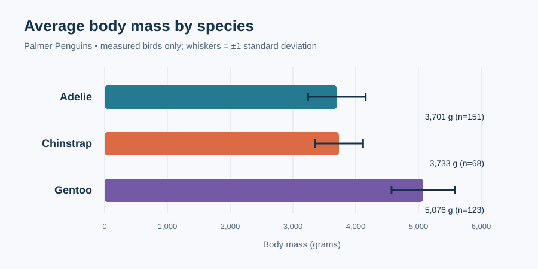

# Palmer Penguins: body size across species

**Research question:** How do body mass and bill length vary among Adélie, Chinstrap, and Gentoo penguins in the Palmer Archipelago sample?

## Data and permission

This project uses the simplified `penguins.csv` from the [palmerpenguins project](https://github.com/allisonhorst/palmerpenguins/blob/main/inst/extdata/penguins.csv), reproduced in `data/penguins.csv` for offline reproducibility. The source project states that the data are available under [CC0](https://github.com/allisonhorst/palmerpenguins#license), subject to the Palmer Station LTER and US LTER data policies described there. The original research is Gorman, Williams, and Fraser (2014), *PLOS ONE*, [doi:10.1371/journal.pone.0090081](https://doi.org/10.1371/journal.pone.0090081). The CSV has 344 observations from 2007–2009. Its SHA-256 is `f204db2c753b0937caac3cb35258562c14f073e4bbc76be24b4c51ce22767a93`.

## Methods and tools

`analyze.py` uses Python's standard library (`csv`, `statistics`, and SVG text generation). It excludes `NA` or blank values only for the measurements needed by each chart. It computes the mean and sample standard deviation of body mass for each species, then plots individual birds by bill length and body mass. These are descriptive comparisons, with no significance test or causal claim. `requirements.txt` records that no external Python packages are needed.

## Findings

Gentoo penguins have the highest mean measured body mass: **5,076 g** across 123 birds, compared with **3,701 g** for 151 Adélie birds and **3,733 g** for 68 Chinstrap birds. The whiskers show one standard deviation, not a confidence interval.

The 342 complete observations show species clusters and overlap. Gentoo birds are generally heavier; Chinstrap birds tend to have longer bills than Adélie birds. The scatter plot preserves individual variation that the means hide.

**Limitation:** This is a sample from selected Palmer Archipelago islands and years. Missing measurements are excluded, and species differences may also reflect sex, island, or year. The results should not be generalized to all penguins or interpreted causally.

## Reproduce the analysis

1. Install Python 3.9 or newer.
2. Clone or download this repository.
3. From the repository root, run `python3 -m pip install -r requirements.txt` (there are no third-party dependencies).
4. Run `python3 analyze.py`.
5. Read the printed sample sizes and means. The command regenerates `figures/mean_body_mass.svg` and `figures/bill_length_vs_mass.svg` from the included CSV.

No credentials, personal information, or restricted data are used.
